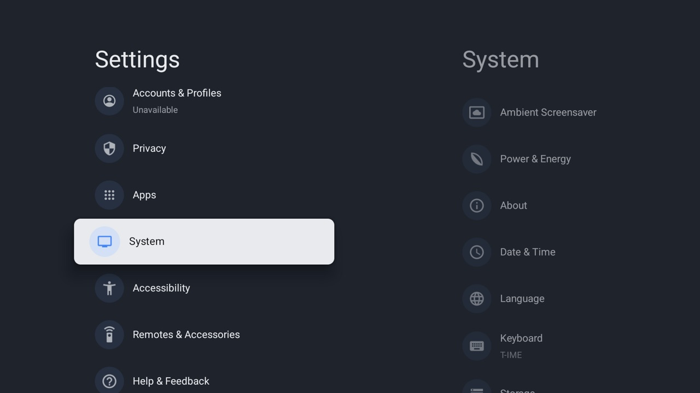
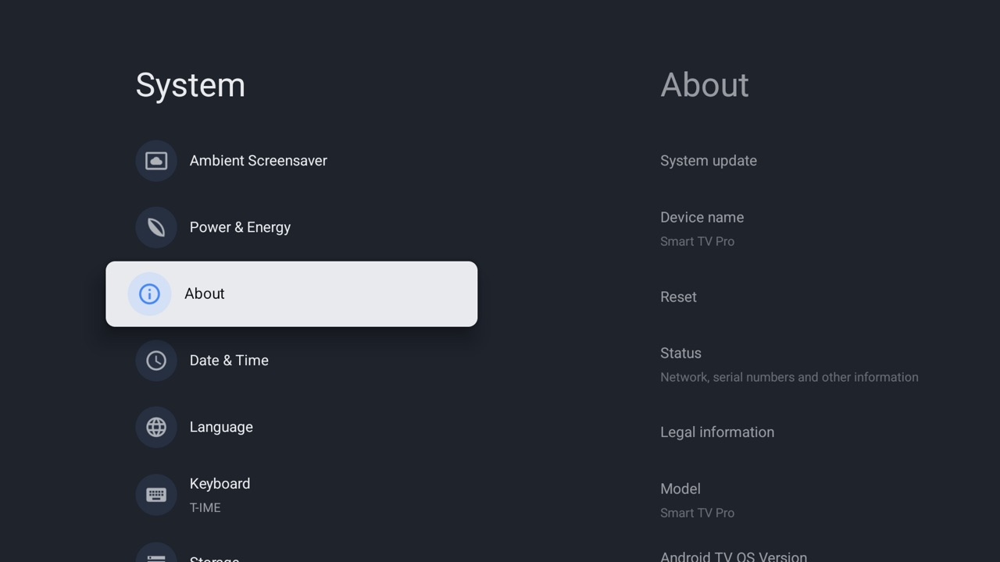
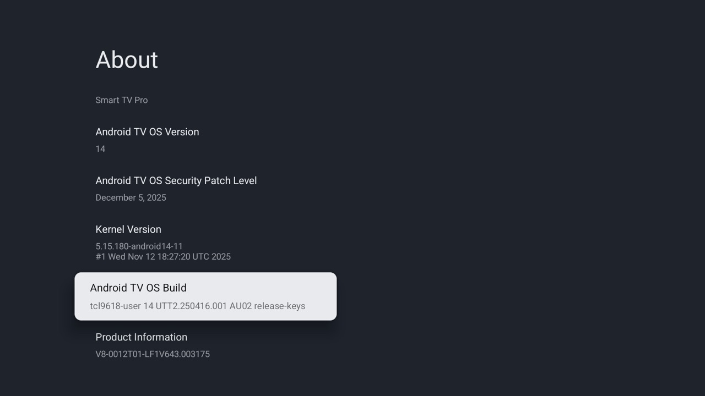
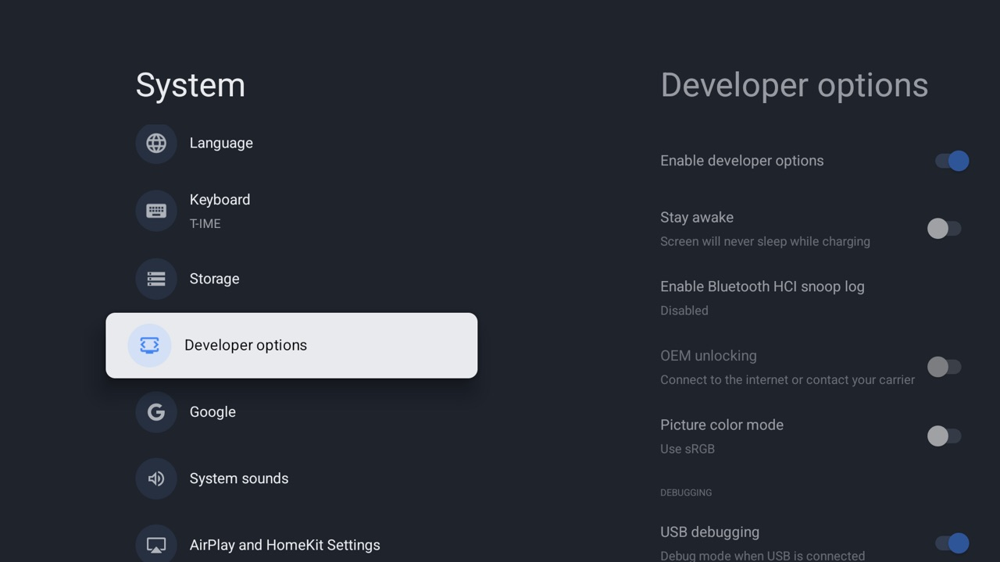
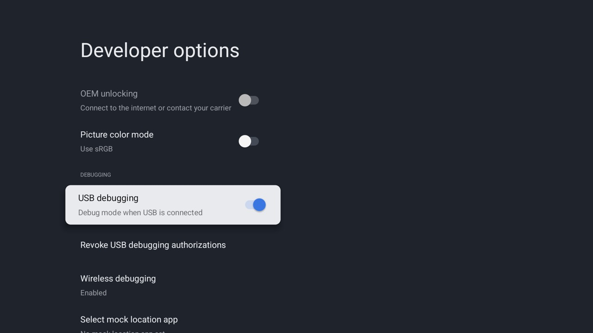
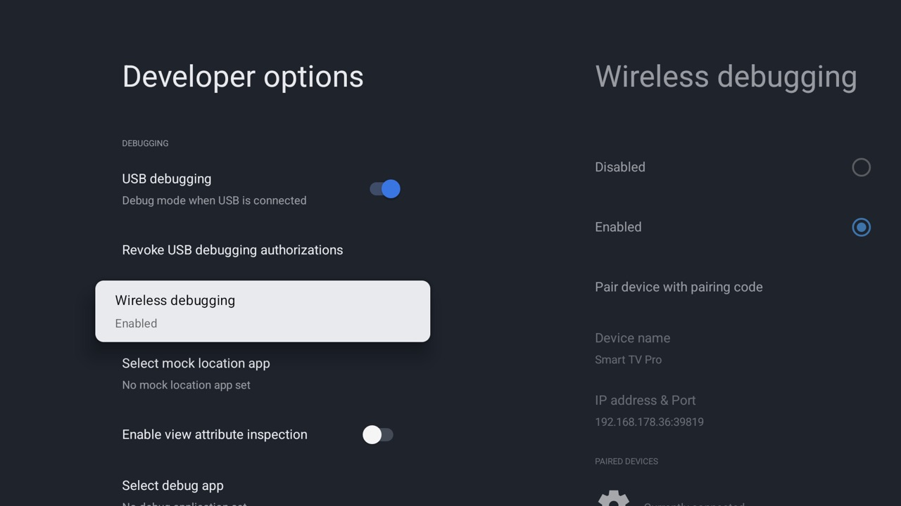

# Enable USB and wireless debugging on the TCL TV

The scripts in this repo (`./tv`, `tools/check.sh`, `launcher/build-and-install.sh`) talk to the TV over
ADB on the network. That needs **USB debugging**. On this TCL it also opens network ADB on port 5555,
which is what the scripts use. **Wireless debugging** is optional.

Screenshots: TCL Smart TV Pro (G08), Google TV / Android 14, firmware UTT2.250416.001.
Use the remote: arrows to move, OK to select, Back to go back.

## 1. Open Settings → System

Press Home, open the **Settings** tile in DumbTV (or the gear button on the remote), scroll down to
**System** and press OK.



## 2. Open About



## 3. Press OK on "Android TV OS Build" seven times

Scroll down to **Android TV OS Build** and press OK seven times in a row. After a few presses the TV
counts down ("You are now 3 steps away..."), then says **"You are now a developer!"**. If it asks for a
PIN, enter the TV's PIN. If it says you already are a developer, developer options are already on.



## 4. Go back and open Developer options

Press Back once. **Developer options** now appears in the System list, below Storage.



## 5. Turn on USB debugging

Scroll down to the DEBUGGING section and switch **USB debugging** on (confirm the warning with OK).
That's all the scripts need: this TCL then also listens for ADB on the network at
`<TV IP>:5555`, and keeps doing so after a reboot.



Don't touch **Enable developer options** at the top of this list: switching it off also switches
debugging off.

## 6. Optional: Wireless debugging

**Wireless debugging** is Android's newer, encrypted way to connect. It shows its own address with a
changing port (here `192.168.178.36:39819`) and needs pairing with a code
(`adb pair`, then `adb connect`). The scripts here don't need it. It switches itself off whenever the TV
loses the network, so it's mainly useful for a one-off connection from Android Studio's `adb`.



## 7. Allow your computer, once

The first time a computer connects (for example `./tv --probe`), the TV shows
**"Allow USB debugging?"** with the computer's key fingerprint. Tick **"Always allow from this
computer"** and press **Allow**. Without the tick, it asks again on every connection.

Then check it works:

```bash
./tv --probe
```

It prints the model, Android version and firmware.

## Find the TV's IP address

Settings → Network & Internet → your Wi-Fi network → IP address, or in the FRITZ!Box under
Home Network → Network (the TV is called `Smart-TV-Pro`). The scripts use `192.168.178.36`; for another
address prefix any command with `TV_HOST=<ip>`.

## Turning it off again

Switch **USB debugging** off in Developer options. DumbTV, the remote buttons and everything else keep
working; only the scripts can't reach the TV until you switch it back on. **Revoke USB debugging
authorizations** (just below it) forgets every computer you allowed, so each has to be allowed again.

## Trouble connecting

- **"No route to host"** with the TV on: macOS is blocking your terminal from the local network. Allow it
  in System Settings → Privacy & Security → Local Network (see the README's gotchas).
- **TV in standby**: it drops off Wi-Fi; turn it on with the remote.
- **No "Allow USB debugging?" prompt** and the connection hangs: make sure the TV is on and showing a
  picture, then connect again. If it still doesn't appear, restart the TV (hold the power button on the
  remote, then Restart) and try once more.
